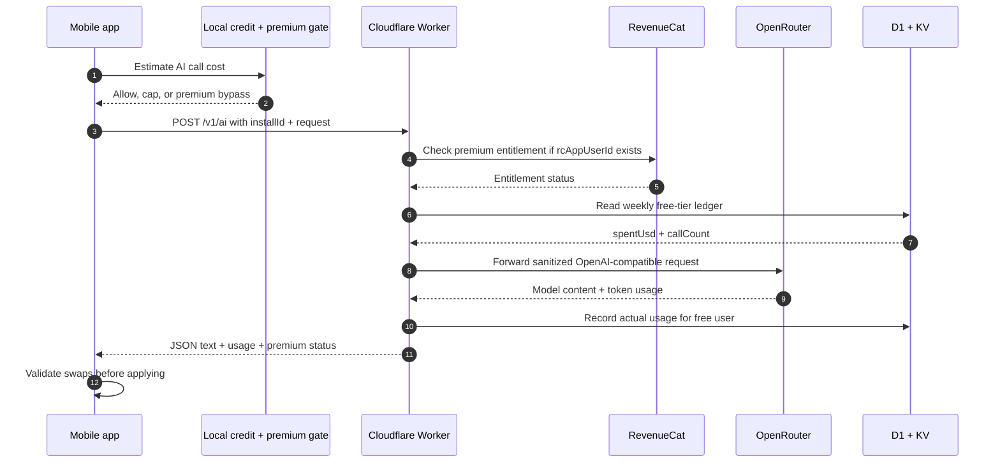

<div align="center">
  
</div>

<h1 align="center">Weekly Flow</h1>

<p align="center">
  <strong>AI-assisted weekly planning for students and busy people who need schedules that flow around real commitments.</strong>
</p>

<p align="center">
  
  
  
  
  
</p>

Weekly Flow is an AI-assisted weekly planning app for students and busy people who need a schedule that adapts around fixed commitments. The app combines a deterministic local scheduler, chronobiology-based timing and activity-sequencing rules grounded in cited research, on-device retrieval that answers most activities without an AI call, timetable photo OCR, LLM reranking, saved-plan learning, Google Calendar sync, and a production-style Cloudflare Worker backend with D1, KV, and Workers AI for credits, analytics, embeddings, and cross-device sync.

The organising principle throughout: **AI is constrained, never trusted.** The scheduler works offline, the model can only narrow a pre-verified citation list rather than author one, retrieval exists to avoid paid calls, and every model suggestion is validated before it is applied.

This repository contains the production mobile app in `mobile/`, the Cloudflare Worker backend in `server/`, and design/prototype material used to shape the iOS experience.

## Project Snapshot

| Area | What It Shows |
|---|---|
| Product | A native-feeling weekly planner with onboarding, timetable import, day/week schedule views, activity editing, insights, saved plans, settings, subscriptions, and sync. |
| Scheduling | A local deterministic scheduling engine with chronobiology priors, directional activity-pair scoring, soft constraints, seeded variants, and learned preferences from kept plans. |
| AI | Vision OCR, activity-name classification, reranking, prompt sanitization, cache validation, cost logging, and evals. |
| Research | A citation-backed timing library where every user-facing claim resolves to a real paper, an on-device retrieval (RAG) layer that answers most activities without an AI call, and a privacy-preserving shared vocabulary derived from real usage. |
| Backend | Cloudflare Worker proxy with KV-backed credit caps, D1 analytics/sync, RevenueCat entitlement checks, and Apple/Google identity-token verification. |
| Portfolio Value | Demonstrates mobile engineering, applied AI product design, backend security boundaries, subscriptions, calendar sync, and eval-driven LLM work. |

## What It Does

- Builds a weekly schedule from activities, target hours, wake/sleep hours, work-free days, and fixed commitments.
- Imports school or work timetables from a photo using a vision model.
- Uses a local scheduling engine first, then optionally asks an LLM to rerank the generated plan.
- Keeps fixed blocks locked so classes, meetings, and calendar events are never moved by the scheduler.
- Lets users regenerate seeded schedule variants without spending AI credits.
- Lets users save "kept plans" and reapply them later as reusable schedule templates.
- Learns soft preferences from kept plans, such as preferred time of day and day of week per activity category.
- Shows day and week views inside the Schedule tab.
- Tracks completed blocks and weekly insights.
- Imports Google Calendar events as fixed blocks and can push Weekly Flow events back to a selected calendar with explicit consent.
- Supports optional Sign in with Apple cross-device sync for saved plans and week history.
- Supports subscriptions through RevenueCat, with a free weekly AI credit cap for non-premium users.
- Explains *why* every block sits where it does, in plain language, with tappable links to the real research behind it.
- Derives timing from the activity's name, so "email triage" and "write thesis" are scheduled differently even though both are desk work.
- Lets users add an optional description ("hard intervals, not a recovery spin") that sharpens both retrieval and classification.
- Answers most new activity names by on-device vector retrieval instead of a paid AI call.
- Understands directional activity pairs, favouring useful sequences such as strength before endurance or exercise before focus while separating repetitive high-load work.
- Keeps pairwise reasoning auditable: semantic retrieval may shortlist a rule, but enum-constrained predicates decide whether it can affect placement and the applied reason is stored on the block.
- Builds a shared activity vocabulary from what people actually schedule, released only above a k-anonymity threshold.

## Product Experience

| Surface | User Value | Implementation |
|---|---|---|
| Welcome + Import | Start with activities or import a class/work timetable from a photo. | `WelcomeScreen`, `PhotoUploadScreen`, `parseTimetableViaAI()` |
| Activities | Add activity goals, weekly hours, auto-inferred or manual categories, an optional description, and name-based timing guidance with the research behind it. | `ActivitiesScreen`, `ActivityEditSheet`, `classifyActivityNames()`, `retrieve()` |
| Schedule | Switch between week-at-a-glance and single-day views; regenerate variants; move, lock, complete, or inspect sequence-aware blocks. | `ScheduleScreen`, `WeekScreen`, `TodayScreen`, `BlockDetailSheet`, `sequenceLibrary.ts` |
| Saved Plans | Keep useful schedules, reapply them, and learn user preferences from those choices. | `KeptPlansSheet`, `preferences.ts`, `learnFromLikedPlans()` |
| Insights | Track scheduled hours, completion, category mix, rest days, and overloaded days. | `InsightsScreen`, `summarize()` |
| More / Settings | Configure wake/sleep hours, work-free days, Google Calendar, AI status, credits, subscriptions, sync, and privacy. | `SettingsScreen`, `PaywallSheet`, `googleCalendar.ts`, `sync.ts` |

## Tech Stack

### Mobile App

- Expo SDK 54
- React Native 0.81.5
- React 19.1
- TypeScript 5.4 with strict mode
- React Navigation 6
  - Native stack
  - Bottom tabs
  - iOS-style form sheet modals
- React Native Safe Area Context and React Native Screens for native navigation layout
- Expo Blur for the custom glass-style tab bar
- Expo Dev Client for native development builds
- AsyncStorage for local app state
- Expo SecureStore for install IDs, credit ledger data, OAuth/session tokens, and local secrets
- Expo Image Picker for camera and photo-library timetable import
- Expo Auth Session and Web Browser for Google OAuth
- Expo Apple Authentication for Sign in with Apple
- Expo Updates for OTA update checks
- Expo Crypto for random IDs and digest operations
- RevenueCat (`react-native-purchases`) for subscriptions and premium entitlement checks
- Sentry React Native for optional remote AI/error logging
- React Native SVG for iconography
- EAS Build/Submit configuration
- Generated Android native project for custom native builds

### Backend

- Cloudflare Workers
- TypeScript
- Wrangler
- Cloudflare KV for server-side weekly AI credit ledgers
- Cloudflare D1 (SQLite) for kept-plan analytics and cross-device sync data
- Cloudflare Workers AI (`@cf/baai/bge-small-en-v1.5`) for text embeddings behind `/v1/embed`
- See [WHY_CLOUDFLARE.md](WHY_CLOUDFLARE.md) for why this stack over Supabase
- OpenRouter Chat Completions API for LLM calls
- RevenueCat REST API for server-side premium entitlement validation
- Apple and Google JWKS verification for native sign-in identity tokens
- Web Crypto for JWT verification and HMAC-signed app sessions

### AI and Evaluation

- OpenRouter direct-client mode for local prototyping
- Cloudflare Worker proxy mode for production so the OpenRouter API key is never bundled into the app
- Vision OCR for timetable photos
- Text reranking for schedule improvement suggestions
- Activity-name classification for category and timing refinement
- Prompt injection sanitization before user text enters prompts
- Input size caps for image and text prompts
- One-retry network policy with timeouts
- AsyncStorage-backed LLM rerank cache with TTL and LRU eviction
- Offline eval runner for rerank and vision features
- HTML eval reports with pass/fail, cost, token, and vision F1 metrics

### Tooling

- npm
- TypeScript compiler
- ESLint
- tsx for eval scripts
- dotenv for eval and local environment loading
- Gradle through the generated Android project
- EAS CLI for mobile builds
- Wrangler CLI for backend deploys

## Architecture

<div align="center">
  
</div>

```text
WeeklyFlow/
|-- mobile/                 # Expo + React Native app
|   |-- App.tsx              # Root navigation, OTA updates, Sentry, RevenueCat init
|   |-- src/
|   |   |-- components/      # Reusable UI components
|   |   |-- data/            # Scheduler, AI, sync, credits, calendar, telemetry
|   |   |   |-- researchLibrary.ts       # Citations, archetypes, transitions, effects
|   |   |   |-- sequenceLibrary.ts       # Directional pair rules, contexts, predicates, reasons
|   |   |   |-- research.ts              # Name classifier + category/band notes
|   |   |   |-- placementRules.ts        # Citation effects -> scheduler rules, relaxation ladder
|   |   |   |-- explain.ts               # Builds the "why this slot" copy
|   |   |   |-- suggestionEmbeddings.json # 109 x 384 activity vectors (the corpus)
|   |   |   |-- researchEmbeddings.json  # 49 x 384 paper vectors (the corpus)
|   |   |   |-- sequenceEmbeddings.json  # 9 x 384 directional pair vectors
|   |   |   |-- personLibrary.ts         # Chronotype/age papers + PROFILE_EFFECTS
|   |   |   |-- profileRules.ts          # rMEQ scoring, phase shift, curve transforms
|   |   |   |-- activitySuggestions.ts   # Curated autocomplete dictionary
|   |   |   `-- vocab.ts                 # Shared vocabulary client (read-only)
|   |   |-- inference/       # Activity, research, and directional-pair retrieval
|   |   |   |-- corpusText.ts            # The only place that decides what gets embedded
|   |   |   |-- queryText.ts             # Stage 1: own description, or borrowed crowd words
|   |   |   |-- embedClient.ts           # Stage 2: /v1/embed, null on any failure
|   |   |   |-- vectorSearch.ts          # Stage 3: cosine backend (the Vectorize seam)
|   |   |   |-- corpora.ts               # Loads all three tables, hash-checks freshness
|   |   |   |-- retrieve.ts              # Stage 4: reuse decision + top-k papers
|   |   |   |-- sequenceRetrieve.ts      # Pair retrieval + directional predicate guard
|   |   |   |-- collect.ts               # Stage 5: novel descriptions -> /v1/retrievals
|   |   |   `-- types.ts                 # Shapes + every threshold, in one place
|   |   |-- screens/         # App screens and modal sheets
|   |   |-- state/           # ScheduleContext app state provider
|   |   |-- theme.ts         # Light/dark tokens and category colors
|   |   `-- types.ts         # Shared domain types
|   |-- scripts/
|   |   |-- model-creation/  # Builds the corpora + exports the training set
|   |   `-- inspectEmbeddings.ts         # Read-only view of both vector tables
|   |-- evals/               # Offline LLM eval harness
|   |-- android/             # Generated native Android project
|   |-- app.json             # Expo configuration
|   `-- eas.json             # EAS build profiles
|
|-- server/                  # Cloudflare Worker backend
|   |-- src/index.ts         # Route handlers for AI, events, auth, sync
|   |-- src/auth.ts          # Apple/Google identity-token verification and sessions
|   |-- src/sync.ts          # D1 merge logic for saved plans/week history
|   |-- schema.sql           # D1 (SQLite) schema
|   |-- test/                # Miniflare integration + auth unit harness
|   `-- wrangler.toml        # Worker bindings and runtime vars
|
|-- weekly-flow-design/      # Claude Design handoff/prototype files
|-- another-design-maybe/    # Alternative design exploration
|-- weeklyflow-privacy/      # Privacy page scaffold
`-- README.md
```

## Scheduling Engine

<div align="center">
  
</div>

The scheduler is intentionally local-first. It can generate a usable schedule without the network or AI.

Core techniques:

- Greedy schedule generation with soft constraints.
- Chronobiology priors encoded as hourly fit curves.
- Category-specific daily caps to reduce burnout.
- Session chunking by ideal session length.
- Wake/sleep buffers so work is not placed immediately after waking or too close to sleep.
- Per-activity timing curves inferred from activity names.
- Enum-constrained activity contexts and directional pair scoring.
- Work-free day constraints.
- Locked fixed blocks placed first.
- Deterministic seeded variants for free local regeneration.
- Learned preference bias from saved plans.
- Alternate-slot suggestions for schedule swaps.

The high-level flow is:

1. Fixed blocks are placed first.
2. Activities are split into chunks based on their ideal session length.
3. Chunks are sorted by category priority so narrow timing windows get first pick.
4. Every valid free slot is scored using the activity timing curve, same-day load, nearby activity order, and user preferences.
5. The best slot is selected for canonical schedules; seeded variants choose from near-best slots.
6. The LLM can rerank the result, but its suggestions are validated before they are applied.

The main implementation lives in `mobile/src/data/scheduler.ts`.

### Scoring Signals

| Signal | Why It Matters |
|---|---|
| Chronobiology fit curves | Places analytical, physical, creative, reading, and social work into stronger time windows. |
| Fixed-block occupancy | Protects imported timetable and calendar commitments before movable activities are placed. |
| Daily category caps | Prevents plans from overloading one category on a single day. |
| Wake/sleep buffers | Avoids scheduling immediately after waking or inside the wind-down window. |
| Name-derived timing | Lets "email triage" and "write thesis" behave differently even if both start as desk work. |
| Directional sequence fit | Rewards useful ordering, discourages conflicting or redundant pairs, and decays adjacency effects across each rule's evidence window. |
| Same-day compatibility | Spreads demanding physical or cognitive sessions even when they are not directly adjacent. |
| Learned preferences | Uses kept plans to softly bias future schedules toward the user's demonstrated preferences. |
| Seeded variation | Produces different near-best schedules without spending AI credits. |

## Research-Backed Timing

Weekly Flow tells the user *why* an activity landed where it did. Research claims are backed by a real paper; humane product defaults that have no direct study are labeled as practical instead of borrowing an unrelated citation, and a learned answer is labeled as the user's preference. That distinction is only useful if citations are impossible to fabricate, so the system is built around that constraint rather than around the model.

### The library

`mobile/src/data/researchLibrary.ts` is a hand-curated registry:

| Table | Size | Contents |
|---|---|---|
| `CITATIONS` | 49 | Verified papers: title, DOI/PMC link, open-access flag, a plain-language clause, and a 2–3 sentence outcome-first summary. Two exercise-order papers support sequence rules but intentionally declare no time-of-day effect. |
| `ARCHETYPES` | 40 | Offline activity patterns (regex → category, load, intensity, preferred bands) with cold-start citation candidates used only when paper retrieval is unavailable. |
| `TRANSITIONS` | 4 | Legacy load-level sequencing effects, with a bounded scheduling delta. |
| `SEQUENCE_PATTERNS` | 9 | Directional, predicate-guarded pair rules with explicit research/practical provenance. |
| `CITATION_EFFECTS` | 26 | The papers that actually *move the scheduler*, expressed as activity/person-scoped band biases, spacing rules, and session-length caps. |

Citation prose is original wording, never pasted from a publisher abstract. Links resolve only to `doi.org`, `pubmed`, or `pmc.ncbi.nlm.nih.gov`.

### The fabrication firewall

An LLM is never allowed to produce a citation. It may only ever *narrow* a shortlist that the app already verified:

1. Retrieval builds a candidate list of citation ids, every one of which resolves in `CITATIONS`.
2. The prompt shows the model only those ids, and states they are the only ones it may return.
3. `narrowCites()` intersects the model's answer with the offered list and re-checks every survivor against `CITATIONS`.
4. An id that was invented, or was never offered, is discarded. An empty or malformed answer falls back to the full shortlist rather than stripping the activity's research.

The model can therefore subtract, never add. Evals assert each of those properties directly.

### Retrieval (RAG)

Most activity names miss the ~40 local regexes. Rather than spend an AI call on each, the app embeds the name and finds its nearest neighbours among a precomputed dictionary of 109 activities.

```text
name + optional description
        |
        v
  local regex classifier          instant, offline, always runs
        |
        v
  embed query -> cosine vs activity + paper vectors (384-dim)
        |
        +-- score >= 0.72  -> REUSE the archetype's timing verbatim. No AI call.
        +-- paper hit >= research floor -> direct RAG evidence candidates
        +-- activity score >= 0.45       -> fallback candidates for the model
        |
        v
  LLM classify, grounded in that shortlist        only when retrieval was inconclusive
        |
        v
  final time band -> CITATION_EFFECTS direction gate -> card + scheduler
```

`REUSE_MIN` (0.72) is deliberately far stricter than the 0.45 search floor: showing a wrong search result costs a glance, but silently adopting the wrong activity's schedule mis-places blocks all week without telling anyone. An eval recomputes the separation from the shipped vectors on every run, so changing the embedding model fails the build instead of quietly degrading placement.

**The corpus is a bundled JSON file, not a vector database.** Across 109 activity, 49 paper, and 9 sequence entries, a full scan takes well under a millisecond, roughly a thousand times faster than a network round trip to a hosted index, and it costs nothing per query. It also keeps ranking deterministic and pinned to the app version, which is what makes the thresholds testable offline. `VectorSearchBackend` in `src/inference/vectorSearch.ts` is the seam where a hosted index would drop in; that tradeoff would flip if the corpus ever needed to grow without an app release.

**Papers are embedded too, not just activities.** Retrieval used to reach research only *through* an activity — it found the nearest dictionary entries and offered their citations — so a description could only ever surface papers that some pre-existing activity already cited. Each paper now has its own vector built from its title, finding, concise outcome, verified subject terms and timing claim. Exact subject-term matches are merged with semantic candidates before structured ranking, so a paper with a broad title can still be retrieved by its actual activity without adding an activity-specific scheduler rule.

Direct paper hits replace an activity's hand-attached fallback candidates; they are not appended behind them. Retrieval still produces candidates rather than truth. Once the scheduler knows the person and final band, a symbolic gate checks each candidate's load, intensity, chronotype, age and signed `CITATION_EFFECTS` value for that band. Only a positive match may reshape the activity curve or appear under “Why this slot.” This is one shared path for every activity, not a collection of name-specific scheduling rules. For example, an early-oriented user's morning swim can use Anderson et al., while a late-day swim can use Baxter and Reilly, Reilly and Edwards, and Lok et al. A busy later schedule can still make morning the strongest overall opening because research is one weighted input rather than a hard command. When no retrieved paper supports the chosen hour, the card says it was the strongest workable opening instead of borrowing an adjacent claim.

The hybrid paper search retains twenty internal candidates, adds exact matches from verified paper topics, prioritizes candidates whose structured activity/person scope matches, and then keeps at most five. This prevents a valid placement paper from being crowded out by several slightly higher-scoring context-only papers. Starter activities use their bundled dictionary vectors to run the same RAG locally, so a sample swim can receive evidence for its actual window without a manually attached starter citation or a network request.

Each paper's embedded timing claim is derived mechanically from `CITATION_EFFECTS` and phrased **wake/sleep-relative** ("in the last hours before sleep"), never as a clock time — the scheduler is wake-relative end to end, so a corpus entry naming an hour would describe a schedule only some users have. An eval asserts no entry contains one.

Every entry carries a **content hash** of the exact text it was built from. A length check catches an added or reordered entry; only the hash catches the silent case, where editing a keyword or a paper's wording changes the text while the id stays valid and the vector quietly describes something that no longer exists.

```bash
cd mobile
npx tsx scripts/inspectEmbeddings.ts             # summary + freshness of activity/research tables
npx tsx scripts/inspectEmbeddings.ts Coding      # nearest activities AND nearest papers
npx tsx scripts/inspectEmbeddings.ts --pairs     # every pair that would trigger REUSE
npx tsx scripts/inspectEmbeddings.ts --research  # activity -> paper reach (tunes RESEARCH_MIN)
npx tsx scripts/inspectEmbeddings.ts --text chang-2012   # the exact embedded string

npm run build:embeddings           # rebuild the activity table (needs a Worker)
npm run build:research-embeddings  # rebuild the paper table  (needs a Worker)
npm run build:sequence-embeddings  # rebuild the directional pair table (needs a Worker)
npm run inspect:sequence           # calibrate real ordered-pair queries (needs a Worker)
```

### Directional activity sequencing

Timing retrieval answers "when is this activity individually strongest?" The sequence layer separately asks "what state does it leave the person in, and what sensibly belongs before or after it?" Keeping these questions separate prevents a pairwise concern from distorting the activity's chronobiology curve.

`mobile/src/data/sequenceLibrary.ts` defines nine directional patterns. Each activity receives a closed `ActivityContext` containing a subtype, physical and cognitive demand, and enum-constrained tags. The scheduler uses those contexts to:

- Prefer evidence-backed or practical orderings such as strength before endurance, movement before focus, and focus before recovery.
- Penalize the reverse or repetitive arrangements, including endurance before strength, wet-to-dry workout transitions, and stacked high-load sessions.
- Apply adjacency effects only inside the pattern's `maxGapHours`, with linear falloff, while handling broader redundancy through a separately clamped same-day score.
- Record the exact rule, related block, evidence type, explanation, and citations that materially affected placement.
- Accept ask-once user preferences such as preferring an order, reversing it, separating the pair across days, or allowing it unchanged.

The context flags are symbolic metadata, not extra embedding coordinates: the vector width remains 384. The optional sequence RAG embeds an explicitly ordered `from -> to` query and shortlists at most four patterns above `SEQUENCE_MIN` (0.55). Cosine similarity never has authority by itself: the matching pattern must still pass its structured directional predicates, so a semantically similar reversed pair cannot activate the forward rule. Runtime embedding is reserved for materially uncertain pairs and cached; obvious high-confidence pairs stay local and spend no retrieval credit. If embedding is unavailable or stale, scheduling falls back to the complete local pattern table and remains deterministic offline. `npm run inspect:sequence` probes both directions and verifies that expected rules survive the shortlist and predicate guard.

### Person-fit: choosing between near-equal slots

The library above answers "when does this **activity** belong?". It routinely
narrows a week down to two or three about-equally-good slots and then settles
the tie by array order. A second, separate library answers the question that
only makes sense afterwards — "when does it belong **for this person**?" — and
settles it on evidence instead.

`mobile/src/data/personLibrary.ts` is its own registry, deliberately not merged
into `CITATIONS`:

| Table | Size | Contents |
|---|---|---|
| `PROFILE_CITATIONS` | 6 | Verified papers on chronotype phase, the age curve, the synchrony effect, post-meal drowsiness, and the questionnaire itself. |
| `PROFILE_EFFECTS` | 6 | The machine-readable half, guarded on `chronotype` / `ageBand` (and optionally load) rather than on load alone. |

Keys resolve through both registries, which is how `facer-childs-2015` finally
computes: it has been cited since the beginning for saying that peak
performance tracks time since waking and varies by chronotype, and it has never
moved a block, because until there was a profile there was no chronotype to
compute against.

**Two mechanisms, not one.** A chronotype is a *phase* — the whole fit curve
slides — plus a *tilt* on specific bands. Phase is kept strictly separate from
the user's wake hour, and that separation is the point: `fitScoreFrom` already
indexes `hour − wake + 1`, so folding chronotype into wake time would look
equivalent, but a night owl who has to be up at 07:00 for work has an early
wake hour and a late internal peak. Collapsing the two erases exactly the
person the feature exists for.

Phase papers such as Baehr et al. and Roenneberg et al. calibrate the person's
overall daily curve. They are shown in the profile explanation, not repeated
on every activity card. Only profile findings with an activity guard—such as
the physical-performance chronotype finding—are attached to the matching
activity as evidence.

```text
curveFromTiming      the archetype's claim about this KIND of activity
      |
      v
+ band biases        cited + personal, per band
      |
      v
shiftCurve(phase)    slide it to where THIS person's clock sits
      |
      v
applyMealDip         the one clock-anchored effect, so it goes last
```

Biases are applied **before** the shift. They are body-clock claims —
monk-2005 is explicit that the afternoon dip runs on an internal rhythm and
appears whether or not you ate — so the whole shape has to travel together.
Applying them afterwards pinned the dip near 13:00 for everyone, which made a
shifted night owl take the dip penalty across their own late-morning peak. The
measured effect of getting this wrong was an early-vs-late placement spread of
eight hours; corrected, it is three, which tracks the −1.5…+2.0h phase spread
the papers actually support.

**It is a lookup table, not a second RAG.** Retrieval exists upstream because
activity names are open-ended and nobody can enumerate what people will type. A
profile is not: chronotype is one of three values, age one of five bands. A
cosine over six papers would add a threshold and a failure mode to a question a
table answers exactly, and would make placement non-deterministic — breaking
the seed-0 guarantee `checkStarterWeeks.ts` pins.

**No MBTI.** There is no credible literature linking a type indicator to
activity timing. The available route — MBTI → Big Five → time-of-day — is a
two-hop chain where every link resolves and the conclusion appears in none of
them, which is the resolvable-but-wrong failure the relevance guard already
exists to catch. Chronotype, age and meal time are the axes the evidence
supports; "morning person or night owl" is what people mean anyway.

**A null profile is the identity, everywhere.** Same rules, same curve,
byte-identical week at seed 0. Asserted directly, so shipping this moved no
existing user's schedule.

### Collecting what the corpus cannot explain

When retrieval finds nothing close enough to reuse, that activity is evidence of a gap. The app sends the query, its already-computed vector, and what it ranked against to `POST /v1/retrievals`, which stores it in D1 as the training set for the next corpus. It rides the same `shareAnalytics` opt-out as kept-plan analytics — one switch the user can find, not a second quieter one — and is purged with the linked install by `DELETE /v1/account`.

A borrowed crowd description is never stored back as the user's own words: it appears in `query_text`, because that is the literal string the vector encodes, but `description` holds only what this person actually wrote, or nothing. The table has **no read endpoint at all**; `npm run export:novel` reads it with a Cloudflare credential and writes gitignored JSONL, and the only other reader is an aggregate-only count in the viz explorer.

### Correcting what the scanner got wrong

Timetable scanning misreads times, and the misread cannot be repaired downstream: the suspected failure is the vision model writing minutes as decimal digits (`10.45` for 10:45), which is indistinguishable at the number level from a legitimate 10:27. So the review screen after a scan is fully editable — name, day, start and end per row, plus **"Add a block it missed"**, because a class the scan dropped would otherwise become a training row that reads "correctly absent".

Corrections snap to a **5-minute grid** (`snapScan`), not the 30-minute one every manual surface uses (`snapHalf`). Timetables run on quarter hours, and a snap that turned a corrected 8:45 into 9:00 would write the wrong answer into the one set that exists to hold right answers. `npm run check:scans` and `npm run check:fixed` pin both grids.

`buildScanCorrection` (`mobile/src/data/scanCorrections.ts`) aligns prediction against truth by block id and emits one row per pair — `unchanged` / `edited` / `removed` / `added`, with a null on whichever side is absent. Agreement is kept deliberately: a set holding only corrections would imply the parser is wrong about everything. Days are stored **Monday-based**, rebased out of the user's own week anchor, or rows from Sunday-start and Monday-start users would disagree about facts they agree on.

`POST /v1/scans` stores the pairs in D1. The **photo** is separate: `POST /v1/scans/image` writes it to R2 under `scans/<install>/<scan>.jpg`, behind its own `shareScanPhotos` consent that **defaults to off** — `shareAnalytics` defaults to true, and a timetable photo carries a school or employer, room numbers, often a printed name. Both are purged by `DELETE /v1/account`, objects as well as rows; `listScanImageKeys` walks the bucket prefix rather than the `image_key` column, so an upload whose row update failed can't survive the purge.

### Shared vocabulary

The curated dictionary cannot anticipate what people actually schedule, so the Worker derives a second vocabulary from real usage and serves it at `GET /v1/vocab`.

Two layers of k-anonymity, both enforced in SQL so unqualified rows never materialize:

- An activity **name** is released only once at least 10 *distinct installs* independently typed it.
- A **description word** is released only once at least 10 distinct installs independently used it *for that name* — descriptions are stored raw but never served raw, only as individual words that cleared the gate.

Names and words are additionally screened for digits, handles, emails, and URLs. Per-term population counts are never exposed. Nothing is stored in a separate vocabulary table: it is derived at read time from the same analytics rows, so deleting an account removes that user's contribution automatically.

The app uses the result three ways — enriching the embedding query when the user wrote no description, offering community names below the curated dictionary in autocomplete, and hinting at how others described the same activity. All three degrade silently when the vocabulary is unavailable, which is the normal state on a cold or offline install.

### Plain language, enforced

Research prose is worthless if the reader bounces off it, so the card shows one short passage and places the papers inside a tinted "Based on N studies" disclosure. Expanded citations use full-contrast text, while profile-specific timing directions emphasize words such as "earlier" and "later." Two eval guards keep the prose readable:

- A banned-stem list (`cortisol`, `circadian`, `consolidat`, `cognitiv`, …) applied to every user-facing string. Name the effect someone can feel, never the mechanism.
- A sentence-length cap: 16 words for text on the card face, 22 for citation clauses behind the disclosure.

Both apply to model-written text too, since the classify prompt lets the LLM author a note for novel activities — without the guards the first unrecognised activity would quietly reintroduce jargon.

## AI Design

Weekly Flow uses AI as an assistant, not as the source of truth.

- `parseTimetableViaAI()` reads a photo and returns fixed blocks.
- `classifyActivityNames()` refines activity categories and timing attributes from names.
- `rerankSchedule()` asks the model for a small set of schedule swaps after the local scheduler has already created a plan.
- `applySwaps()` rejects invalid model output, including overlaps, locked-block moves, off-day placements, and pre-sleep violations.
- `aiSanitize.ts` cleans and flags user-controlled strings before prompt construction.
- `aiCache.ts` caches validated rerank swaps to reduce latency and cost.
- `aiLogger.ts` records latency, tokens, estimated cost, retries, errors, cache hits, and sanitizer flags.

For local development, the mobile app can call OpenRouter directly. For production, `EXPO_PUBLIC_AI_PROXY_URL` routes all AI calls through the Worker so the OpenRouter key stays server-side.

### Production AI Flow



## Backend Routes

The Cloudflare Worker exposes these endpoints:

| Route | Purpose |
|---|---|
| `POST /v1/ai` | Validates AI request bodies, checks premium/credit status, forwards to OpenRouter, records usage. |
| `POST /v1/embed` | Embeds up to 8 texts (max 512 chars each) via Workers AI (`@cf/baai/bge-small-en-v1.5`, 384-dim) for semantic search and retrieval. Returns `capped: true` with HTTP 200 rather than 402 when the weekly budget is spent, so search never paywalls. |
| `POST /v1/retrievals` | Stores a novel activity description and its vector in D1 as future training data, when the shipped corpus had nothing close enough to reuse. Anonymous, gated on the analytics opt-out, idempotent on a client id. Write-only — there is no read route. |
| `POST /v1/transition-feedback` | Stores an ask-once directional pair answer, its validated contexts, proposed choice, final order, and retrieved rule ids. Consent-gated, idempotent, and write-only. |
| `GET /v1/vocab` | Serves the shared activity vocabulary and description words that cleared the k-anonymity gate. No install id, no body — the response is identical for every caller. Cached 24h. |
| `POST /v1/events` | Stores anonymous kept-plan analytics in D1. |
| `POST /v1/auth/apple` | Verifies native Sign in with Apple identity tokens and returns an app session token. |
| `POST /v1/auth/google` | Same, for Google Sign-In identity tokens. |
| `GET /v1/sync` | Pulls synced saved plans and week history for the signed-in user. |
| `POST /v1/sync` | Pushes local saved plans and week history to D1 with merge rules. |
| `DELETE /v1/account` | Erases the account and all server data for it (App Store guideline 5.1.1(v)). |

### Backend Storage Map

| Store | Data | Reason |
|---|---|---|
| KV `WF_CREDITS` | Per-install weekly AI credit ledger | Server-side free-tier caps; TTL handles rollover GC. |
| D1 `events` + `placements` | Anonymous kept-plan analytics, including activity names and optional descriptions | Product analysis for scheduling defaults and classifier tuning; also the source the shared vocabulary is derived from at read time. Free text is stored raw and never served raw. |
| D1 `novel_descriptions` | Activity descriptions the shipped corpus could not resolve, with the query vector and what it ranked against | The training set for the next corpus — by construction these are the activities the current one cannot explain. Write-only: no endpoint serves it, and any future one must k-anonymize like `/v1/vocab`. |
| D1 `transition_feedback` | Directional activity-pair questions and the user's answer | A consent-gated training/evaluation set for improving ambiguous pair rules. Context fields are enum-validated; raw names/descriptions are write-only and account deletion purges the linked install. |
| D1 `users` | Apple/Google `sub` mapped to internal user IDs | Minimal account identity for optional cross-device sync. |
| D1 `week_snapshots` | Frozen history by user and week | Lets week history follow the user across devices. |
| D1 `synced_liked_plans` | Saved plan templates and delete tombstones | Union-by-id sync with delete propagation. |

## Security and Privacy Techniques

- The production path keeps the OpenRouter key inside the Cloudflare Worker.
- The Worker rechecks RevenueCat entitlements before bypassing the free AI cap.
- Free-tier AI usage is enforced both locally and server-side.
- The local credit ledger is stored in SecureStore and signed with a per-install secret.
- User text is sanitized before being embedded into prompts.
- Suspicious prompt-injection patterns can block a metered AI call before credits are spent.
- Oversized image and prompt payloads are refused before provider calls.
- Google OAuth tokens and sync session tokens live in SecureStore, not AsyncStorage.
- Google Calendar writes require an explicit in-app consent toggle.
- App-owned Google Calendar events are tagged with private extended properties so external events are not modified.
- Sign in with Apple tokens are verified against Apple's JWKS, issuer, audience, expiry, signature, and nonce.
- Cross-device sync uses HMAC-signed bearer sessions.
- Sync merge behavior is additive and failure-tolerant so local app use is not blocked by server issues.
- Kept-plan analytics are gated at a single call site by an opt-out the user controls in Settings; activity descriptions ride the same switch rather than a separate one.
- The shared vocabulary applies k-anonymity in SQL, so text below the threshold is never loaded into Worker memory, let alone returned.
- Activity descriptions are stored raw but never served raw — only individual words that at least 10 distinct installs independently used for the same activity.
- The vocabulary is derived at read time from existing analytics rows, so no separate per-user vocabulary table exists to leak, and account deletion removes a user's contribution automatically.
- `GET /v1/vocab` sends no install id and no request body, so reading the vocabulary discloses nothing about the device.

## Mobile Setup

Requirements:

- Node.js 18 or newer
- npm
- Expo CLI / EAS CLI as needed
- Xcode for iOS builds or Android Studio for Android builds

```bash
cd mobile
npm install
cp .env.example .env
npm start
```

Useful mobile commands:

```bash
npm run ios
npm run android
npm run web
npm run lint
npm run typecheck
npm run eval
npm run eval:rerank
npm run eval:vision
```

If native modules change:

```bash
npx expo prebuild
```

## Mobile Environment Variables

Copy `mobile/.env.example` to `mobile/.env`.

Important variables:

| Variable | Purpose |
|---|---|
| `EXPO_PUBLIC_OPENROUTER_API_KEY` | Direct OpenRouter key for local prototype mode. Do not ship this in production. |
| `EXPO_PUBLIC_OPENROUTER_MODEL_VISION` | Vision-capable model for timetable OCR. |
| `EXPO_PUBLIC_OPENROUTER_MODEL_TEXT` | Text model for rerank and classification. |
| `EXPO_PUBLIC_OPENROUTER_APP_NAME` | Optional OpenRouter app title metadata. |
| `EXPO_PUBLIC_OPENROUTER_APP_URL` | Optional OpenRouter referer metadata. |
| `EXPO_PUBLIC_AI_PROXY_URL` | Production Worker endpoint, usually ending in `/v1/ai`. |
| `EXPO_PUBLIC_EVENTS_URL` | Optional kept-plan analytics endpoint override. Usually derived from the proxy URL. |
| `EXPO_PUBLIC_TRANSITION_FEEDBACK_URL` | Optional activity-pair feedback endpoint override. Usually derived from the proxy URL. |
| `EXPO_PUBLIC_SCANS_URL` | Optional timetable correction endpoint override. Usually derived from the proxy URL. |
| `EXPO_PUBLIC_APP_VERSION` | Optional app version stamped on analytics events. |
| `EXPO_PUBLIC_SYNC_URL` | Optional sync endpoint override. Usually derived from the proxy URL. |
| `EXPO_PUBLIC_SENTRY_DSN` | Optional Sentry DSN. |
| `EXPO_PUBLIC_REVENUECAT_IOS_KEY` | RevenueCat iOS public SDK key. |
| `EXPO_PUBLIC_REVENUECAT_ANDROID_KEY` | RevenueCat Android public SDK key. |
| `EXPO_PUBLIC_PRIVACY_URL` | Optional privacy-policy override shown from the paywall/settings. Defaults to `https://weeklyflow-privacy.vercel.app/`. |
| `EXPO_PUBLIC_TERMS_URL` | Optional custom EULA URL. Defaults to Apple's Standard EULA. |
| `EXPO_PUBLIC_GOOGLE_CLIENT_ID_IOS` | Google OAuth client ID for iOS. |
| `EXPO_PUBLIC_GOOGLE_CLIENT_ID_ANDROID` | Google OAuth client ID for Android. |
| `EXPO_PUBLIC_GOOGLE_CLIENT_ID_WEB` | Google OAuth client ID for web/Expo Go. |

## Server Setup

```bash
cd server
npm install
npx wrangler login
```

Create the KV namespace and D1 database, copy the printed ids into the bindings in `server/wrangler.toml`, then load the schema:

```bash
npx wrangler kv namespace create WF_CREDITS
npx wrangler d1 create weekly-flow-events
npx wrangler d1 execute weekly-flow-events --remote --file=./schema.sql
```

Databases created before the activity-description column exists need it added once by hand — D1 has no `IF NOT EXISTS` for `ADD COLUMN`, so a "duplicate column name" error on a fresh database is expected and harmless:

```bash
npx wrangler d1 execute weekly-flow-events --remote \
  --command "ALTER TABLE placements ADD COLUMN activity_description TEXT"
```

The Workers AI binding used by `/v1/embed` needs no provisioning — declaring it in `wrangler.toml` is enough. Note that it always calls the real service, even under `wrangler dev`.

Set Worker secrets:

```bash
npx wrangler secret put OPENROUTER_API_KEY
npx wrangler secret put REVENUECAT_REST_API_KEY
npx wrangler secret put SYNC_JWT_SECRET
```

Run the test suite (Miniflare, no deploy or login needed):

```bash
npm test
```

Deploy:

```bash
npm run typecheck
npm run deploy
```

Point the mobile app at the deployed Worker:

```text
EXPO_PUBLIC_AI_PROXY_URL=https://weekly-flow-ai.<account>.workers.dev/v1/ai
```

## Subscription Model

Weekly Flow has a free tier with a small weekly AI budget and a premium tier with unlimited AI.

The paywall displays the localized prices returned by the current App Store storefront through RevenueCat; it does not show hard-coded fallback prices. Package resolution accepts the standard RevenueCat package identifiers, offering aliases, configured App Store product IDs, or matching monthly/yearly subscription periods. Introductory pricing is shown only when RevenueCat confirms that the current Apple ID is eligible. Initialization is idempotent, retries after transient failure, and purchase/restore actions report when subscriptions are unavailable instead of silently returning a failed purchase.

- Client-side gate: `mobile/src/data/credits.ts`
- Entitlement source of truth: `mobile/src/data/entitlements.ts`
- Server-side enforcement: `server/src/index.ts`
- Paywall UI: `mobile/src/screens/PaywallSheet.tsx`

Before submitting an iOS build, verify the two App Store products are available in the review storefront, configure the `premium` entitlement and RevenueCat offering, set the production privacy-policy URL (and `EXPO_PUBLIC_TERMS_URL` only if using a custom EULA), and test both Restore Purchases entry points. App Store Connect's App Information and subscription metadata still need their Privacy Policy and Terms of Use URLs set manually; the app links alone do not populate those fields.

RevenueCat entitlement ID:

```text
premium
```

Configured subscription product IDs:

```text
com.weeklyflow.app.premium.monthly
com.weeklyflow.app.premium.yearly
```

## Google Calendar Sync

Google Calendar integration is implemented in `mobile/src/data/googleCalendar.ts`.

It supports:

- OAuth with PKCE.
- Calendar list and calendar creation.
- Pulling external calendar events into Weekly Flow as locked fixed blocks.
- Pushing app-owned activity/manual-fixed blocks to Google Calendar.
- Updating app-owned events when blocks move.
- Importing edits made in Google Calendar back into the app.
- Skipping imported events during push so user-owned calendar events are never overwritten.

## Cross-Device Sync

Cross-device sync is optional and supports native Sign in with Apple and
Google. The two providers intentionally create separate accounts; they are
never linked by email.

Flow:

1. The app requests a native identity token from Apple or Google.
2. The Worker verifies the token against that provider's JWKS.
3. The Worker mints an HMAC-signed app session.
4. The app stores the session token in SecureStore.
5. Saved plans and week history sync through D1.

Apple and Google sign-ins are separate accounts by design - accounts are never linked by email, because Apple private-relay addresses make email an unreliable identity key.

For a build to offer Google sign-in, set the platform-specific
`EXPO_PUBLIC_GOOGLE_CLIENT_ID_*` value in `mobile/.env` and include the same
client ID in the Worker's comma-separated `GOOGLE_CLIENT_ID` variable. Native
Apple sign-in uses the app bundle ID (`com.weeklyflow.app`) as its audience.

Merge strategy:

- Week snapshots are last-write-wins by `capturedAt`.
- Saved plans are unioned by ID.
- Deleted plans use tombstones so deletions propagate across devices.
- Server-side retention caps bound per-user storage.

## Evals

The eval harness lives in `mobile/evals/` and uses the same prompts as the production app.

```bash
cd mobile
npm run eval
npm run eval:rerank
npm run eval:vision
npm run eval:research    # deterministic, no API key, no network
npm run eval:reminders
```

The eval runner writes HTML reports to:

```text
mobile/evals/results/latest.html
```

Rerank evals validate that model-proposed swaps still satisfy constraints. Vision evals compare parsed timetable entries against fixture JSON using precision, recall, and F1.

The research suite is the largest and runs entirely offline — no API key, no network, no cost — so it can gate every commit. It currently asserts 1134 properties, including:

- Classifier coverage and intent ordering ("movie research for thesis" is deep work; "watching movies" is downtime).
- Registry integrity: every citation resolves, links point at trusted resolvers, and open-access flags match the host.
- Citation *relevance*, not just resolvability — a paper on aerobic exercise cannot be the sole support for when social time belongs.
- Every declared citation effect measurably changes what the scheduler reads and is reachable from an archetype or the direct paper RAG. Decorative research fails the build.
- The fabrication firewall: `narrowCites` drops invented ids, drops unoffered ids, and falls back rather than stripping an activity's research.
- Threshold separation recomputed from the shipped vectors, so a re-embedded table fails loudly.
- Plain-language and sentence-density guards over every user-facing string.
- No block is ever lost to an unsatisfiable research rule, and a relaxed rule is surfaced to the user as a caveat instead of being hidden.
- Every context-only citation is reachable from a real archetype or transition; effect-bearing papers may instead use the tested direct-RAG path.
- The person-fit layer is the identity when the profile is unanswered: same rules, same curve, byte-identical week at seed 0.
- Opposite chronotypes measurably move blocks, no chronotype can make an activity unplaceable, and the combined citation + profile bias stays inside its clamp.

Server-side, `cd server && npm test` runs 254 Miniflare checks covering the AI proxy, credit ledger, auth rotation, embeddings, transition-feedback validation and deletion, and the vocabulary k-anonymity gate (including that a term one below the threshold is withheld, and that purging an account removes its contribution).

## Design Artifacts

- `weekly-flow-design/` contains the Claude Design handoff bundle and HTML/CSS/JS prototypes.
- `another-design-maybe/` contains alternate JSX design explorations.
- `Weekly Flow iOS.html` is an exported iOS design prototype.
- `weeklyflow-privacy/` contains a privacy page scaffold.

These files are useful for portfolio storytelling because they show the path from design exploration to production React Native implementation.

## Portfolio Highlights

This project demonstrates:

- Mobile app architecture with React Native, Expo, and TypeScript.
- Offline-first state management without a heavy state library.
- A custom scheduling algorithm with deterministic behavior, explainable scoring, and guarded directional activity sequencing.
- AI integration that is constrained, validated, cached, metered, and observable.
- Production backend patterns using Cloudflare Workers, D1, and KV.
- Secure handling of API keys, OAuth tokens, subscriptions, and session tokens.
- Calendar sync and conflict-aware reconciliation.
- Subscription monetization through RevenueCat.
- Eval-driven development for LLM features, including a 1035-check deterministic suite that needs no API key.
- Retrieval-augmented generation used to *avoid* model calls rather than to decorate them.
- A grounding design where the model can only narrow a pre-verified citation list, never author one.
- Privacy-preserving aggregation: k-anonymity enforced in SQL, with deletion propagating by construction.
- A design-to-implementation workflow from prototypes to a native app.

## Current Status

Weekly Flow is a private portfolio/product repository. The mobile app and Worker are implemented, with local/proxy AI modes, subscription gating, Google Calendar integration, and optional cross-device sync paths. Before publishing this repository publicly, add or confirm the license you want to use.
